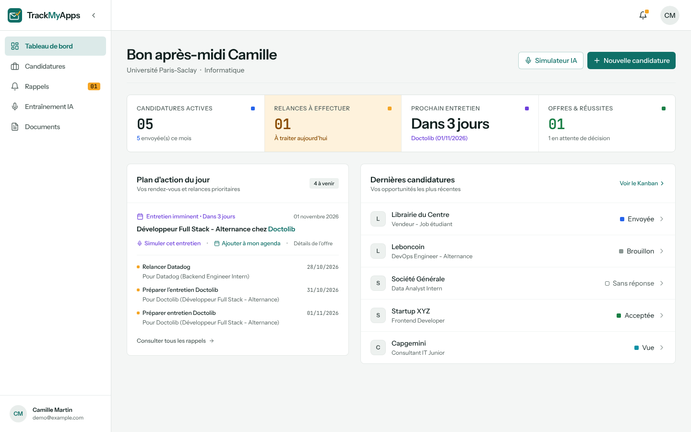
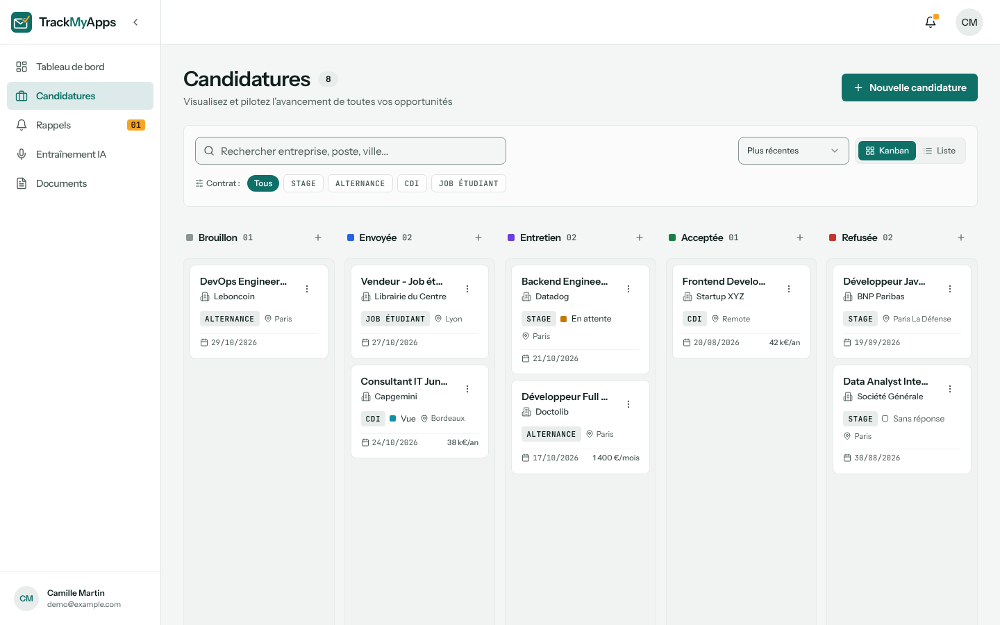
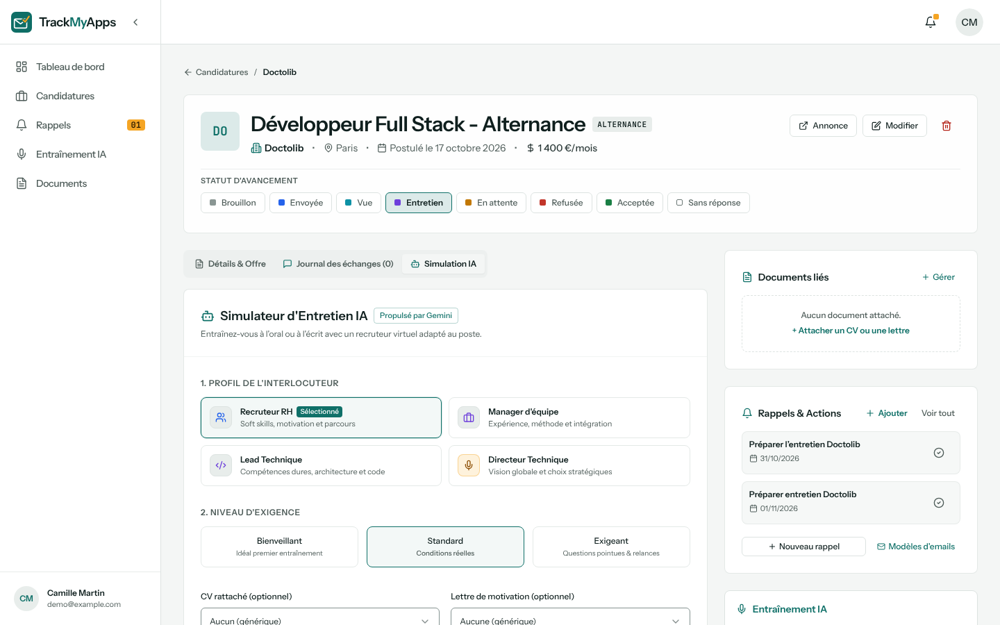
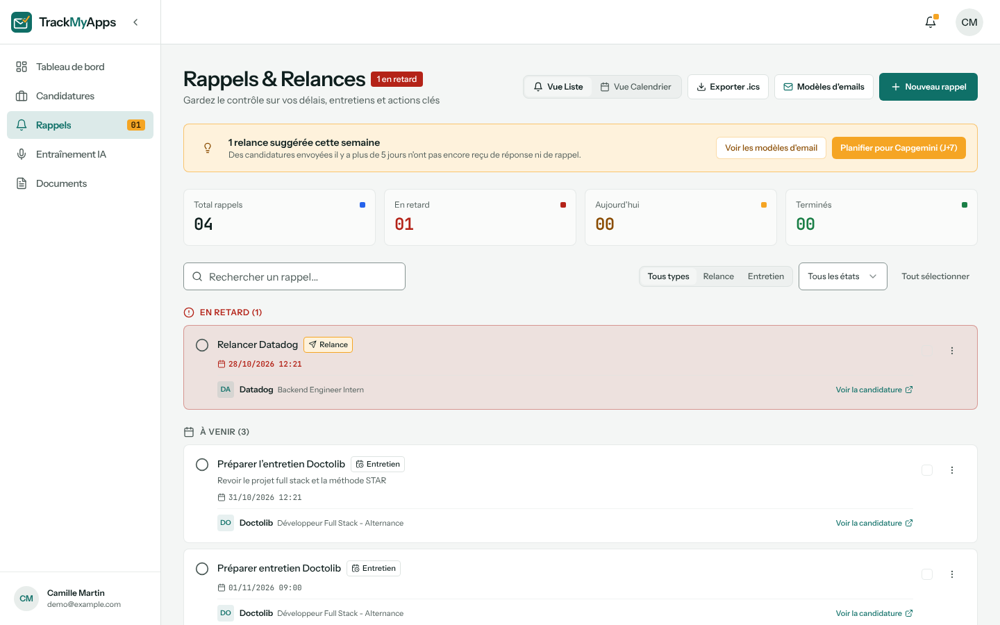
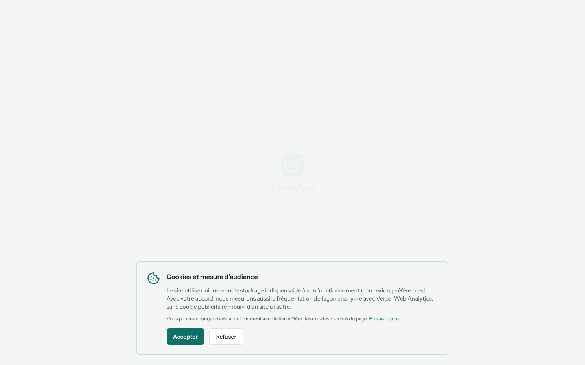
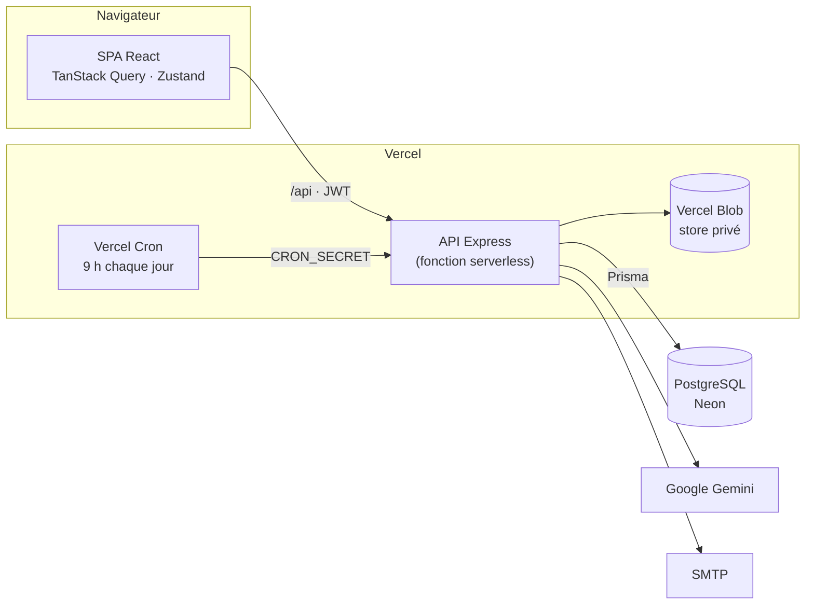

<div align="center">


# TrackMyApps

**Le suivi de candidatures pensé pour les étudiants : stages, alternances, CDI et jobs étudiants.**

[](https://github.com/A2Lec/TrackMyApps/actions/workflows/ci.yml)
[](LICENSE)


[**Démo en ligne**](https://track-my-apps.alexisdelecluse.fr) · bouton « Tester avec le compte démo » sur la page de connexion

</div>



## Pourquoi

Une recherche de stage ou d'alternance, c'est vite des dizaines de candidatures, autant de relances à ne pas oublier et des entretiens à préparer. TrackMyApps rassemble tout au même endroit et propose de s'entraîner aux entretiens avec un recruteur simulé par IA.

L'interface est en français.

## Fonctionnalités

| | |
|---|---|
| **Kanban des candidatures** | Glisser-déposer entre les statuts (brouillon, envoyée, entretien, acceptée, refusée), vue liste avec recherche, filtres et pagination, aperçu rapide en panneau latéral |
| **Fiche candidature** | Offre, notes, journal des échanges avec les recruteurs, documents utilisés, rappels liés |
| **Rappels et relances** | Rappels en retard / du jour / à venir, actions groupées, vue calendrier, export Google Agenda, Outlook et `.ics`, relance proposée à J+7 quand une candidature passe en « Envoyée », emails de rappel envoyés par un cron quotidien |
| **Simulateur d'entretien IA** | Entretien écrit ou vocal (dictée et synthèse vocale du navigateur) avec un recruteur Google Gemini adapté au poste, au CV et à la lettre de motivation, puis bilan noté avec points forts, axes de progrès et reformulation STAR |
| **Préparation** | Banque de questions par catégorie, enregistrables depuis une simulation |
| **Documents** | CV et lettres (PDF, DOCX), stockés de façon privée, avec le suivi des candidatures où ils ont servi |
| **Statistiques** | Taux de réponse, entonnoir de conversion, évolution dans le temps |
| **Compte** | Vérification de l'email, mot de passe oublié, export RGPD (JSON / CSV), suppression du compte, thème clair / sombre |

<table>
  <tr>
    <td></td>
    <td></td>
  </tr>
  <tr>
    <td></td>
    <td></td>
  </tr>
</table>

## Stack technique

| Frontend | Backend | Infrastructure |
|---|---|---|
| React 18, TypeScript, Vite | Node.js 22, Express, TypeScript (ESM) | Vercel (deux projets : web et API serverless) |
| Tailwind CSS, shadcn/ui (Radix) | Prisma 6, PostgreSQL | Neon (PostgreSQL) |
| TanStack Query, Zustand | JWT, bcrypt, express-validator | Vercel Blob (stockage privé), Vercel Cron |
| React Hook Form, Zod | Helmet, express-rate-limit | GitHub Actions, Dependabot |
| dnd-kit, Recharts | Google Gemini, Nodemailer | Docker Compose (PostgreSQL local) |

## Démarrage rapide

Prérequis : **Node.js 22** et **Docker** (ou un PostgreSQL 14+ existant).

Cloner le dépôt :

```bash
git clone https://github.com/A2Lec/TrackMyApps.git
```

```bash
cd TrackMyApps && npm install
```

Lancer PostgreSQL dans Docker :

```bash
npm run db:up
```

Installer les deux packages, créer les `.env`, appliquer les migrations et créer le compte démo :

```bash
npm run setup
```

Lancer l'API (port 5000) et le frontend (port 5173) :

```bash
npm run dev
```

Ouvrir http://localhost:5173 et se connecter avec **demo@example.com / Demo1234!** (ou le bouton « compte démo »).

Sans configuration supplémentaire, tout fonctionne en local sauf :

- **les emails** : ils ne partent pas, mais les liens (vérification de l'email, réinitialisation du mot de passe) sont affichés dans les logs de l'API ;
- **le simulateur IA** : chaque utilisateur ajoute sa propre clé Gemini gratuite ([Google AI Studio](https://aistudio.google.com/apikey)) dans Paramètres > Intelligence artificielle. Il est désactivé sur le compte démo.

<details>
<summary>Sans Docker ni scripts racine</summary>

Créer une base PostgreSQL, puis :

```bash
cd backend && npm ci && cp .env.example .env
```

Renseigner `DATABASE_URL` et `JWT_SECRET` dans `backend/.env`, puis :

```bash
npx prisma migrate deploy && npm run db:seed && npm run dev
```

Dans un second terminal :

```bash
cd frontend && npm ci && cp .env.example .env && npm run dev
```

</details>

## Scripts

À la racine :

| Commande | Rôle |
|---|---|
| `npm run db:up` / `db:down` | Démarre / arrête PostgreSQL (Docker) |
| `npm run setup` | Installation complète (dépendances, `.env`, migrations, compte démo) |
| `npm run dev` | API et frontend en parallèle |
| `npm run lint` · `typecheck` · `test` · `build` | Vérifications des deux packages, comme en CI |

Dans `backend/` : `db:migrate` (nouvelle migration), `db:deploy`, `db:seed` (réinitialise le compte démo), `db:studio`, `email:test -- vous@exemple.fr`, `blob:migrate`.

## Variables d'environnement

Tout est documenté dans [`backend/.env.example`](backend/.env.example) et [`frontend/.env.example`](frontend/.env.example).

| Variable | Requise | Rôle |
|---|---|---|
| `DATABASE_URL` | ✅ | Connexion PostgreSQL |
| `JWT_SECRET` | ✅ | Signature des sessions (`npm run setup` en génère un) |
| `FRONTEND_URL` | ✅ en production | Origine(s) autorisée(s) par CORS, base des liens des emails |
| `ENCRYPTION_KEY` | pour le simulateur IA | Chiffre les clés Gemini des utilisateurs (`npm run setup` en génère une ; `GEMINI_MODEL` pour changer de modèle) |
| `EMAIL_USER`, `EMAIL_PASSWORD` | | Envoi des emails (Gmail par défaut, `SMTP_HOST` / `SMTP_PORT` sinon) |
| `BLOB_STORE_ID` (ou `BLOB_READ_WRITE_TOKEN`) | en production | Store Vercel Blob **privé** (`BLOB_STORE_ID` est créé en connectant le store au projet) ; dossier local sinon |
| `CRON_SECRET` | en production | Protège la route du cron quotidien |
| `DEMO_USER_EMAIL` | | Compte démo protégé (lecture seule des paramètres, réinitialisé chaque jour) |
| `VITE_API_URL` | en production | URL de l'API (vide en local : proxy Vite) |
| `VITE_DEMO_EMAIL`, `VITE_DEMO_PASSWORD` | | Affiche le bouton « compte démo » |
| `VITE_SITE_URL`, `VITE_LEGAL_OWNER_NAME`, `VITE_LEGAL_CONTACT_EMAIL` | en production | Éditeur affiché dans les pages légales |

## Architecture



```
TrackMyApps/
├── backend/
│   ├── api/index.ts          # Point d'entrée Vercel (serverless)
│   ├── prisma/               # Schéma, migrations, seed du compte démo
│   └── src/
│       ├── routes/ → controllers/ → services/   # HTTP → validation → logique métier + Prisma
│       ├── middlewares/      # Auth JWT, email vérifié, compte démo, rate limit, erreurs
│       ├── config/           # Prisma, CORS
│       └── __tests__/        # Vitest + Supertest
├── frontend/src/
│   ├── pages/                # Une page par route (chargées à la demande)
│   ├── components/           # Par domaine : applications, interview, reminders… + ui/ (shadcn)
│   ├── services/             # Client API (Axios)
│   ├── hooks/ · lib/ · store/
│   └── __tests__/            # Vitest + Testing Library
├── docker-compose.yml        # PostgreSQL local
└── scripts/setup.mjs         # Installation en une commande
```

## Choix techniques et sécurité

- **Isolation des données** : chaque requête Prisma est filtrée par l'utilisateur connecté ; les identifiants transmis par le client (entreprise, documents, candidature) sont vérifiés avant d'être liés. Des tests couvrent ces contrôles d'appartenance.
- **Documents privés** : les fichiers sont dans un store Vercel Blob privé et ne sont jamais exposés par une URL publique. L'API les diffuse après vérification du propriétaire, et la clé de stockage est exclue de toutes les réponses grâce à l'`omit` global de Prisma.
- **Authentification** : JWT envoyé en en-tête `Authorization` et en cookie `httpOnly`. Le frontend et l'API sont hébergés sur deux domaines `vercel.app` distincts, et les navigateurs bloquent ce cookie tiers ; le jeton est donc aussi conservé côté client. Servir l'API sous le même domaine que le frontend (réécriture `/api`) permettrait de s'en passer.
- **CORS strict** : seules les origines listées dans `FRONTEND_URL` peuvent faire des requêtes authentifiées.
- **Protection contre les abus** : limitation des tentatives de connexion et de réinitialisation, jetons de réinitialisation stockés hachés et à durée limitée, réponse identique qu'un compte existe ou non.
- **Compte démo partagé** : il ne peut pas être verrouillé par un visiteur (identifiants, paramètres et suppression bloqués) et ses données sont recréées chaque jour avec des dates relatives.
- **RGPD** : export complet (JSON / CSV, cellules protégées contre l'injection de formules), suppression du compte avec ses fichiers, pages légales, consentement pour la mesure d'audience.
- **Statuts sans enums Prisma** : les statuts sont des `String` validés par l'application, pour faire évoluer les valeurs sans migration ; les types TypeScript sont partagés entre front et back via `backend/src/types/domain.ts` (types uniquement, importés par le frontend avec l'alias `@domain`).

## Tests et qualité

```bash
npm test
```

- **Backend** : 61 tests (Vitest + Supertest) sur l'authentification, CORS, le contrôle d'appartenance, les documents, le compte démo, le cron et la réinitialisation du mot de passe.
- **Frontend** : 150 tests (Vitest + Testing Library) sur la logique du Kanban, les rappels, les formulaires, les pages et les hooks.
- **CI** (GitHub Actions) : à chaque PR, lint, typecheck, tests et build des deux packages, puis application des migrations sur un PostgreSQL réel avec vérification de leur cohérence avec le schéma, et exécution du seed.

## Déploiement (Vercel)

1. Créer une base [Neon](https://neon.tech) et appliquer les migrations : `DATABASE_URL=… npm run db:deploy --prefix backend`.
2. **Projet API** : racine `backend/`. Variables : celles du tableau ci-dessus, dont `NODE_ENV=production`. Connecter un store **Blob privé** au projet, ce qui crée `BLOB_STORE_ID` (authentification OIDC). Le cron quotidien est déclaré dans `backend/vercel.json`.
3. **Projet web** : racine `frontend/`, framework Vite, `VITE_API_URL=https://<api>.vercel.app/api`.
4. Renseigner l'URL du projet web dans `FRONTEND_URL` côté API.

## Licence

[MIT](LICENSE) © Alexis de Lécluse
